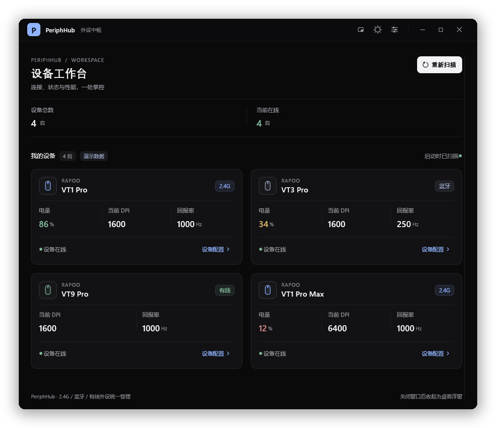
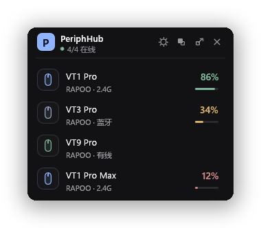
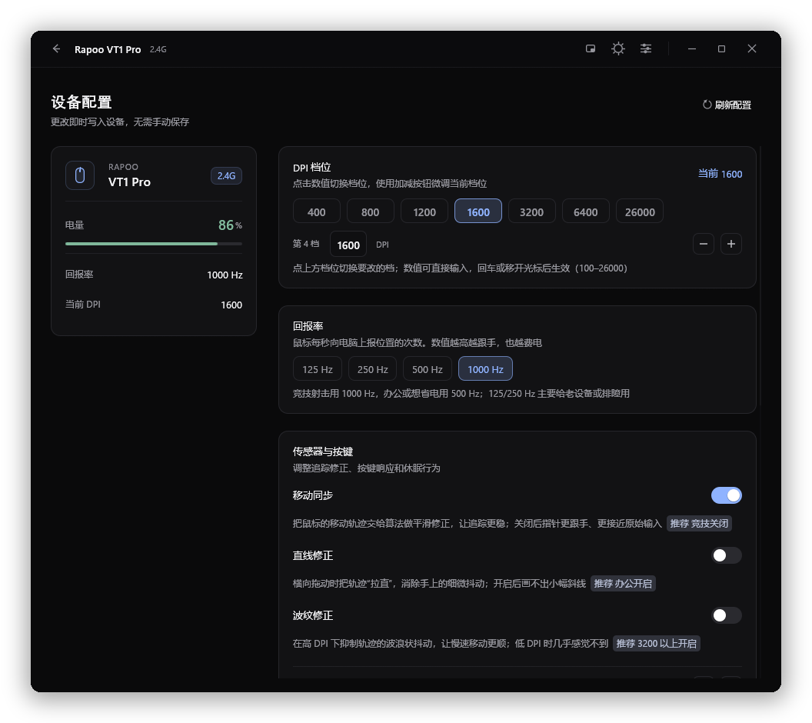
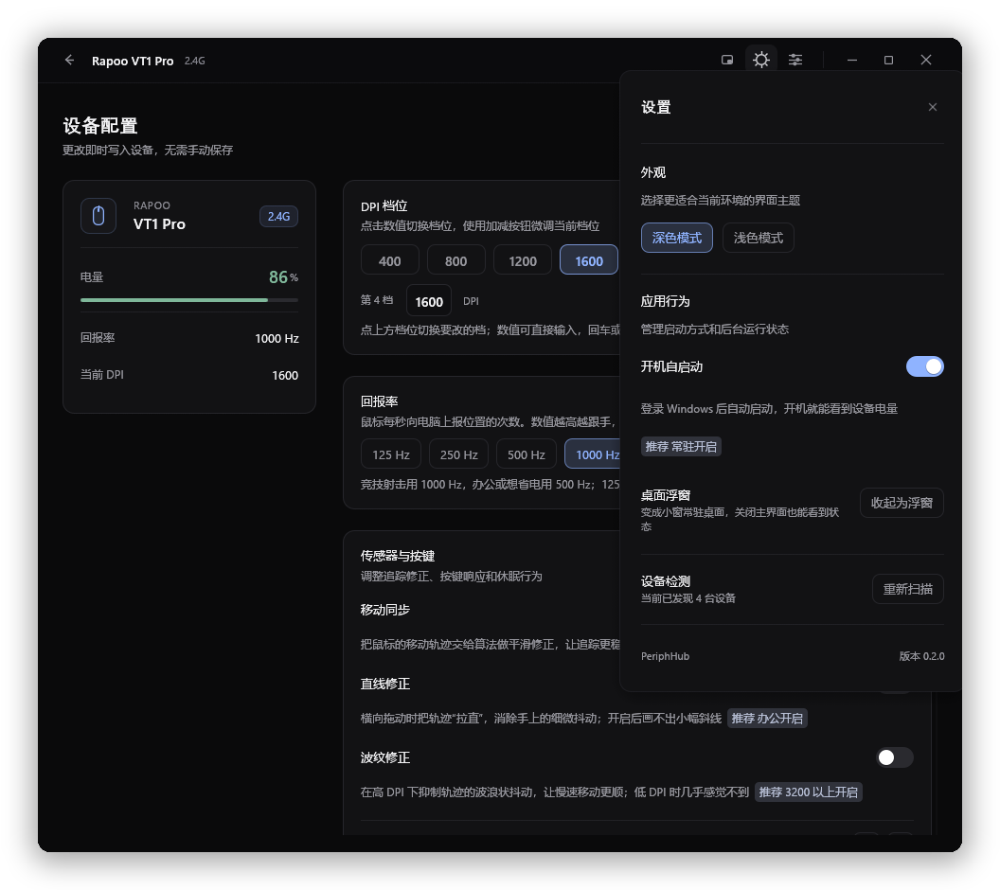

# PeriphHub

一个 Windows 小工具：不装厂商驱动，直接调鼠标的 DPI、回报率、电量等设置。

[](https://github.com/qiuyongjun/PeriphHub/releases)
[](LICENSE)


<p align="center">
  
</p>

## 三步开始

1. 到 [Releases](https://github.com/qiuyongjun/PeriphHub/releases) 下载 `PeriphHub-v*-win-x64.zip`
2. 解压，双击 `PeriphHub.exe`
3. 插上设备，在列表里点开就能调

免安装、不需要管理员权限，删掉 exe 就算卸载完了。

> 程序没做代码签名，首次运行 Windows 可能提示“未知发布者”。
> 点“更多信息”→“仍要运行”即可。Release 里的 `SHA256SUMS.txt` 可用来校验下载文件。

## 能做什么

- **改完就生效**：没有“保存 / 应用”按钮，拖动滑块就是在写设备；连续微调会自动合并，少写硬件存储。
- **鼠标参数**：DPI 各档位、回报率、静默高度、移动同步、防抖、休眠、直线 / 波纹修正、电量。
- **桌面浮窗**：一张小卡片贴在桌面角落，随时看到连接方式、DPI、回报率和电量。
- **系统指针**：指针速度、滚轮行数、整屏滚动。
- **托盘与自启动**：托盘菜单切换主界面 / 浮窗、主题、开机自启动、重新扫描；浮窗模式下只剩托盘图标。
- **深色 / 浅色主题**：主界面和浮窗共用一套配色。

## 界面

| 桌面浮窗 | 设备配置 |
| --- | --- |
|  |  |
| 不打开主界面也能看到每台设备的状态 | 直接读写硬件参数，改完即生效 |

设置面板集中管理主题、开机自启动、浮窗形态和设备重新扫描：

<p align="center">
  
</p>

## 支持哪些设备

| 设备 | VID:PID | 能做什么 |
| --- | --- | --- |
| 雷柏 VT1 Pro（接收器 / 有线） | `24AE:1214` / `24AE:4414` | 完整读写：DPI 档位、回报率、静默高度、移动同步、防抖、休眠、直线 / 波纹修正、电量 |
| 罗技 G304（Lightspeed 接收器） | `046D:C53F` | 5 档 DPI、回报率、电量、设备名 |
| 狼蛛 F87（含 2.4G 接收器） | `3554:FA09` | 只读：显示设备与连接方式 |
| RK98（含 2.4G 接收器） | `25A7:FA70` | 只读：显示设备 |
| 通用有线键盘（F87 / RK98 插线后） | `258A:010C` | 只读：显示设备 |

表里没有的鼠标键盘也会列出来，标成“未适配”，只显示身份和连接状态，不会乱写参数。内置触摸板、虚拟 HID 等系统设备会被自动过滤。

目前只有鼠标能配置；键盘只识别和显示状态，不提供灯效、按键设置。各型号为什么只读，见 [docs](docs/) 里对应的笔记。

## 常见问题

**手边没有设备，想先看看界面？**
设置环境变量 `PERIPHHUB_DEMO=1` 后启动，会用演示数据。本文截图就是演示模式。

**配置和日志在哪？**

- 配置：`%APPDATA%\PeriphHub\config.json`
- 日志：`%LOCALAPPDATA%\PeriphHub\log\periphhub.log`

**怎么卸载？**
在设置里关掉“开机自启动”，退出程序，删掉 `PeriphHub.exe`。想彻底清理，再删上面的两个目录。

**提示缺少 `VCRUNTIME140.dll`？**
很老的系统缺 VC++ 运行库，装一次即可。

**系统要求**：Windows 10 / 11（x64），显卡驱动支持 OpenGL 3.x。

启动行为、浮窗交互、托盘菜单等细节见 [docs/RUN.md](docs/RUN.md)。

## 自己编译

需要 Rust stable（MSVC 工具链），以及 Visual Studio 生成工具里的“使用 C++ 的桌面开发”：

```powershell
cargo run                    # 开发运行
cargo test                   # 只测纯逻辑，不碰硬件
cargo build --release        # 产物：target\release\PeriphHub.exe
```

新增同协议的型号，优先在 [mod.rs](src/driver/mod.rs) 的 `PROFILES` 表里加一条（VID/PID、协议、布局、取值范围），不用复制驱动。

## 发布

版本号只在 `Cargo.toml` 维护。改完版本号提交，然后打 tag：

```powershell
git tag v0.2.0
git push origin v0.2.0
```

推送 `v*` tag 后，GitHub Actions 会跑测试、构建、生成带校验和的 zip 并创建 Release。
本地手动打包：`pwsh scripts/package.ps1`（产物在 `dist\`，加 `-SkipBuild` 可复用已有构建）。

> tag 必须和 `Cargo.toml` 的版本一致（`v0.2.0` ↔ `version = "0.2.0"`），否则工作流会失败。

## 许可证

[MIT](LICENSE)

PeriphHub 是非官方工具，与雷柏、罗技、狼蛛、RK 等厂商无关。改设备参数前请确认风险；
因使用本工具造成的设备异常或数据丢失，作者不承担责任。
